# PaperWeave

**Read a paper as a graph, at the depth you choose.**

PaperWeave is an attempt to make academic papers more accessible. A paper is written as one long line because, for most of its history, it had to be: it was printed on pages, read front to back, and every reader got the same text in the same order. Technology has moved on. A screen can show a reader only the part they need, let them go deeper where they want to, and keep the context one click away, so a linear structure no longer has to be the norm.

PaperWeave turns a paper into a **Work**: a graph of typed **Nodes** (Results, Methods, Concepts, Context, Discussions, a Conclusion) joined by declared **Edges** ("uses", "relies on", "discusses", …). Every Node has up to three **Detail tiers**: a one-line **Gist**, a paragraph-long **Summary** and the **Full** text. A Reader starts from the Results, opens what they need, and reads each piece at the depth that suits them. A newcomer can follow Primers back to the basics, an expert can jump straight to the method details, and a reviewer can see exactly which claims rest on which.

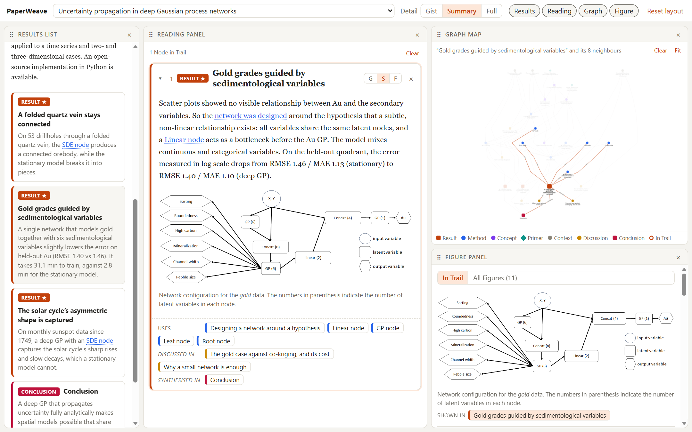

<sub>Screenshots show *Uncertainty propagation in deep Gaussian process networks* (Gonçalves and Wellmann, Mathematical Geosciences), converted from its LaTeX source.</sub>

## Status

A working prototype. Two published papers have been converted and read with it, one from its LaTeX source and one from its PDF alone. The file format, the reading app, a LaTeX class, the converters between them and their tests are in place; what comes next is listed in [docs/deferred.md](docs/deferred.md), and what has been learned from using it in [docs/reading-notes.md](docs/reading-notes.md).

## A tour

### Start from the Results

The **Results list** (left) shows the Abstract, then each Result with its Gist, then the Conclusion: what the paper establishes, before how. Clicking a Result opens it in the **Reading panel** (middle). Everything it depends on or is discussed by is listed under it, one click away.

### Choose the depth: Gist, Summary or Full

The global switch in the top bar sets the Detail tier for every Node; the G / S / F buttons on a Node override it for that Node alone.

| Gist | Summary | Full |
|---|---|---|
| 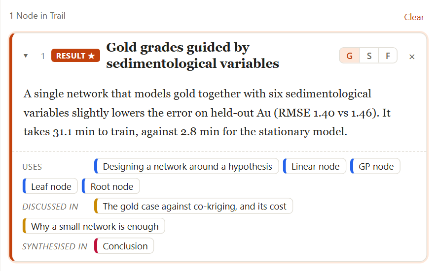 | 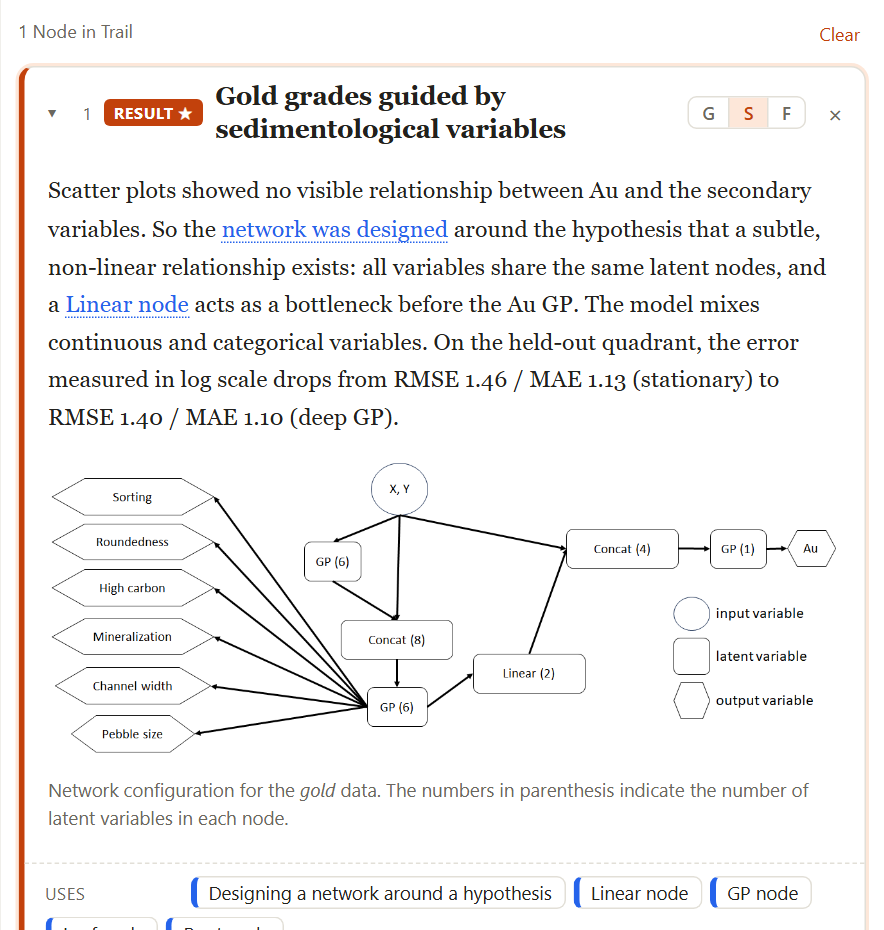 | 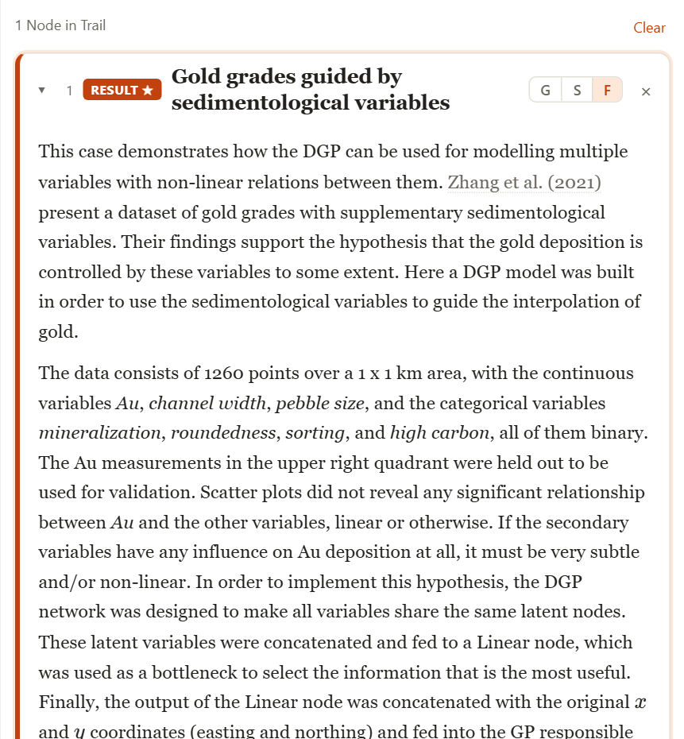 |

### Follow a Trail, kept in Paper order

Every Node you open (from a link in the text, an Edge chip or the Graph map) joins your **Trail**. The Trail stays in **Paper order** (Context, Concepts, Methods, Results, Discussions, Conclusion), so what a Node depends on always appears above it, however you got there.

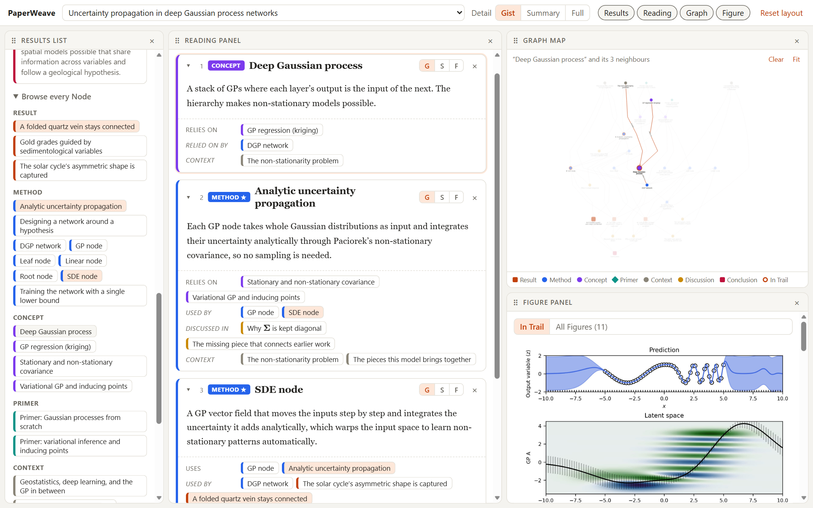

### See where you are on the Graph map

The **Graph map** draws the whole Work in a fixed layered layout, from Context at the top to the Conclusion at the bottom. Opening a Node highlights its **Neighbourhood** (everything one Edge away) and dims the rest.

<p align="center">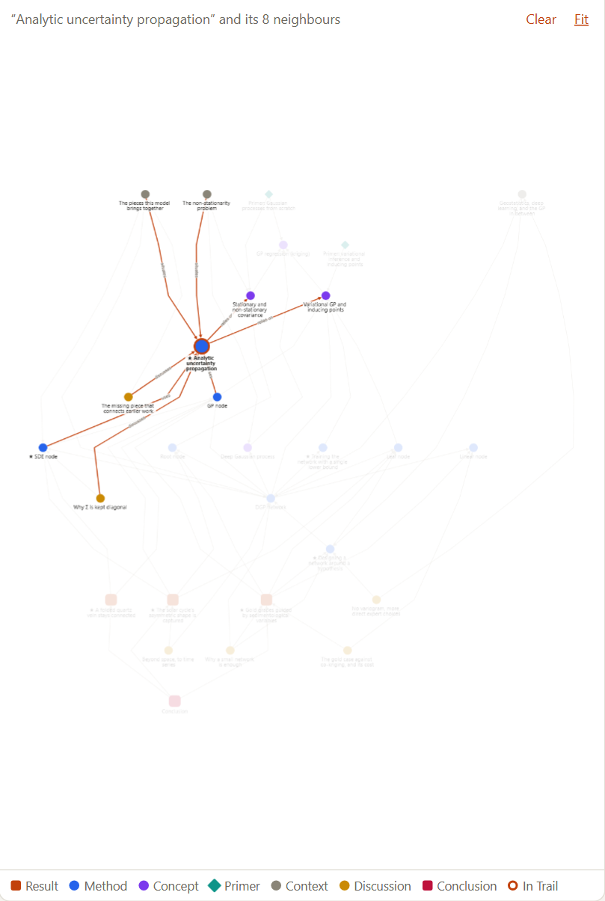</p>

### Equations and Notes, on demand

Equations keep their numbers across the whole Work. Hovering over a reference such as "(12)" shows the equation where you are reading; clicking it opens the Node that holds it. The paper's footnotes become **Notes**: a small number that shows its text on hover, and stays open when clicked.

| Equation reference | Note |
|---|---|
| 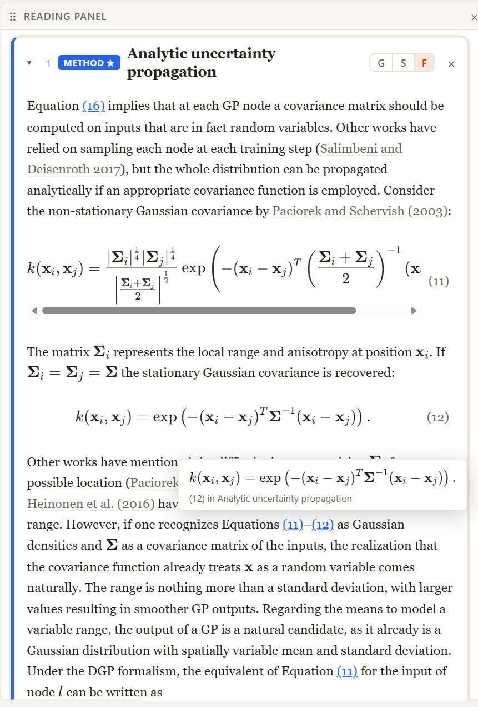 | 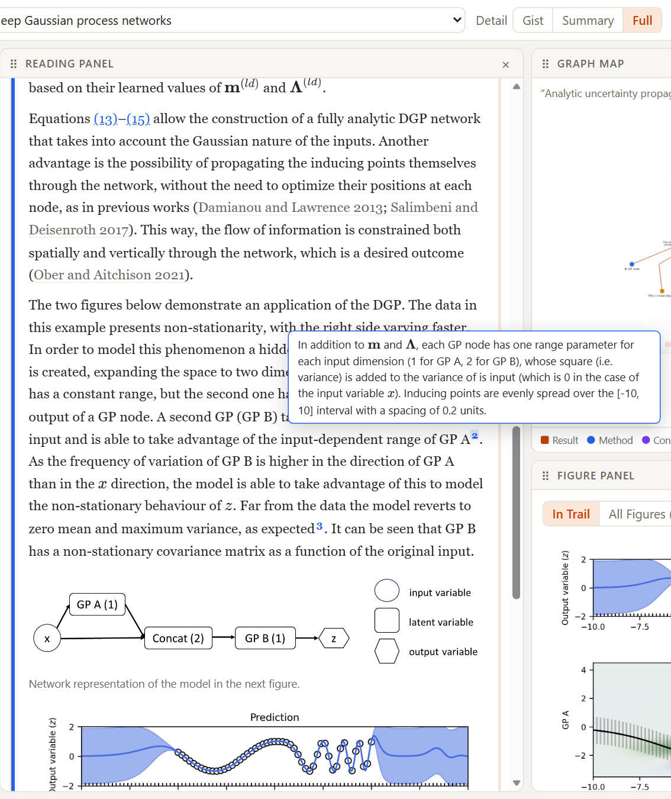 |

### Light or dark

The app follows the system's colour scheme.

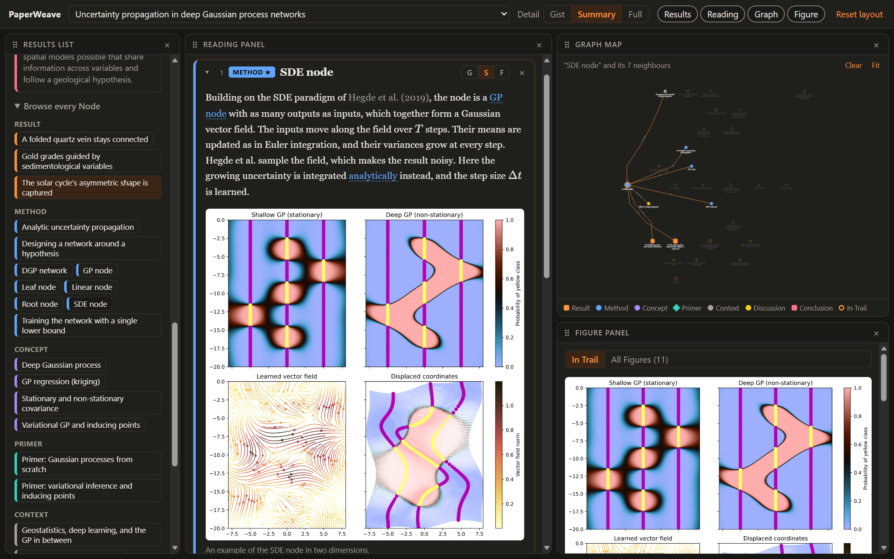

### The Linear version

Every Work also compiles, through a LaTeX class, to a standalone PDF: the graph laid out in Paper order, with the Results up front, each Node's type, Gist and Edges, and its Notes after it. Gist-only and Summary-only versions are one option away.

| Front page | A Method with its Notes |
|---|---|
| 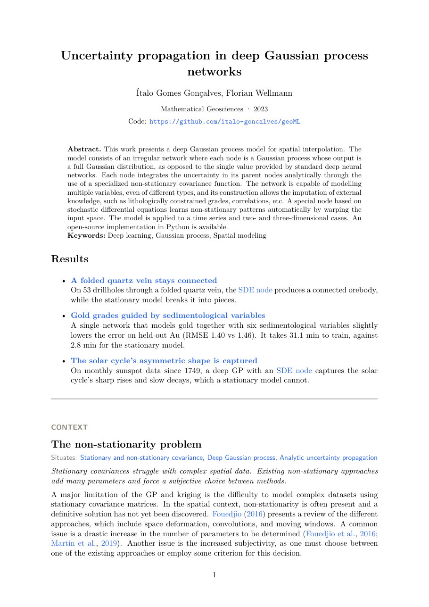 | 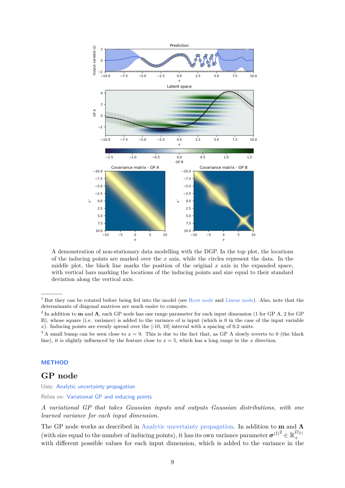 |

## Run it

Needs Node.js 20 or later.

```bash
npm install
npm run dev
```

Then open http://localhost:5173. Every Work under `works/` is bundled in; pick one from the menu in the top bar, or open `?work=<id>` directly.

`works/` is not versioned, so a fresh clone has no Work of its own. To see the app straight away, copy the small sample Work that the tests use:

```bash
mkdir -p works && cp -r fixtures/sample-work works/
```

## Bring your own paper

### Ask Claude Code to convert it

To turn an existing paper into a Work, your own or someone else's that you want to read this way, open [Claude Code](https://claude.com/claude-code) in this repository and ask it to convert the paper, giving the LaTeX source if you have it (an arXiv source download works) or the PDF. The `convert-paper` skill in [.claude/skills/convert-paper/](.claude/skills/convert-paper/) then:

- keeps the paper's own wording in the Full tiers;
- drafts the Gists, Summaries, Primers and Edges;
- has a separate agent check the result against the paper (numbers, equations, references, and whether each Gist says what the paper says);
- writes `sources/<paper>/review.md`, a checklist of everything it drafted, changed, left out or found doubtful.

The Gists and Summaries are a draft in the converter's words until someone checks them against that list. Papers and Works stay in the unversioned `sources/` and `works/` folders.

### Or write the files yourself

A Work is a folder of plain files (`manifest.yaml`, `references.yaml`, `figures/` and one Markdown file per Node), described in [docs/work-format.md](docs/work-format.md). Check a Work after editing it:

```bash
python -P scripts/validate_work.py works/<id>
```

The Python scripts need Python 3.10 or later and PyYAML.

### Or write it in LaTeX

A Work can be written as a LaTeX document in the PaperWeave class (`latex/paperweave.cls`), with one environment per Node:

```latex
\begin{result}[contribution]{result-vein}{A folded quartz vein stays connected}
\uses{sde-node, gp-node}
\gist{On 53 drillholes through a folded quartz vein, the SDE node produces a connected orebody.}
\begin{summary} ... \end{summary}
\begin{full} ... \end{full}
\end{result}
```

The conversion runs both ways, deterministically, and a Work survives Work → LaTeX → Work byte for byte. Building a PDF needs `latexmk`.

```bash
# Work → LaTeX, and its Linear version (--tier=gist|summary for a shorter one, --noprimers to leave Primers out)
python -P scripts/work_to_latex.py works/<id> build/latex/<id> --pdf

# LaTeX → Work (anything outside the class is an error, never silently dropped)
python -P scripts/latex_to_work.py build/latex/<id> works/<id>

# Prepare a paper written in another class for wrapping; every place that needs a decision is marked \todo{…}
python -P scripts/prepare_legacy.py paper.tex build/latex/<id> --id=<id>

# Import a reference manager's .bib, keeping cited entries and listing what to check
python -P scripts/import_bib.py library.bib works/<id>/references.yaml --cited=works/<id>
```

## How it is built

- **The Work format is the hub.** The app, the LaTeX class and the converters all read and write the same files, and anything one form can express has a place in the others ([ADR 0002](docs/adr/0002-work-format-is-the-hub-for-interchangeable-forms.md)).
- **Edges are declared, not inferred** from links in the text, so every line on the Graph map means a real dependency ([ADR 0001](docs/adr/0001-edges-declared-not-inferred-from-inline-links.md)).
- **One Paper order** for the app, the files and the PDF ([ADR 0003](docs/adr/0003-one-paper-order-for-every-form.md)).
- **References are structured fields**, formatted by one author-year style shared by the app and BibTeX ([ADR 0004](docs/adr/0004-structured-references-with-one-author-year-style.md)).

The app is React, TypeScript and Vite, with Cytoscape.js for the Graph map, KaTeX for math and markdown-it for text. The converters and checks are Python.

| Path | What it holds |
|---|---|
| `src/` | The reading app |
| `latex/` | The PaperWeave class and its bibliography style |
| `scripts/` | Converters, the validator and the tests |
| `fixtures/sample-work/` | A small Work that uses every construct of the format |
| `.claude/skills/convert-paper/` | The conversion skill for Claude Code |
| `docs/` | The file format, decisions (ADRs), deferred ideas, reading notes, related work |
| `GLOSSARY.md` | The vocabulary used throughout |

## Tests

```bash
npm test
```

runs the checks on the sample Work: validation, Paper order (the app's and the Python's agree), references (the app's formatting and the bst's agree), equation numbers at every tier, the Work → LaTeX → Work round trip, and the `.bib` importer. `npm test -- works/<id>` runs them on your own Works instead. The checks need Node.js 23.6 or later (which runs the app's TypeScript directly, to compare it with the Python), `bibtex` and `latexmk`.

## Contributing

Ideas, issues and pull requests are welcome. [GLOSSARY.md](GLOSSARY.md) fixes the vocabulary; please use its terms, and add a term there before using a new one. Larger design decisions are recorded as ADRs in [docs/adr/](docs/adr/). Similar projects and how PaperWeave differs from them are in [docs/related-work.md](docs/related-work.md).
